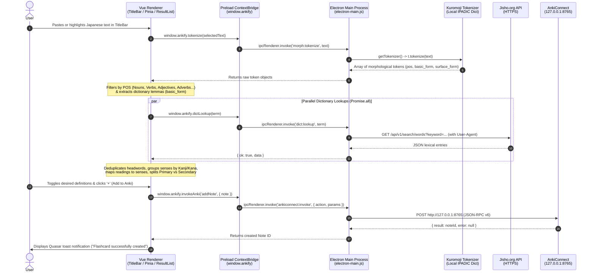

# Ankify ⚡

> **Seamless Japanese-to-Anki vocabulary mining from your macOS menu bar.**  
> Paste or highlight Japanese text anywhere, run instant morphological analysis, curate exact dictionary senses and readings, and export structured flashcards straight to your local Anki collection in one click.

---

## 📖 Table of Contents

1. [Project Overview & Motivation](#-project-overview--motivation)
2. [Technology Stack & Rationale](#-technology-stack--rationale)
3. [System Architecture & Electron IPC Communication](#-system-architecture--electron-ipc-communication)
4. [Deep Dive: Underlying Processes & Code Walkthroughs](#-deep-dive-underlying-processes--code-walkthroughs)
   - [1. Security-First Context Bridging](#1-security-first-context-bridging-electron-preloadjs)
   - [2. Lazy-Initialized Singleton Morphological Analyzer](#2-lazy-initialized-singleton-morphological-analyzer-kuromojijs)
   - [3. Lemmatization & Part-of-Speech Filtering](#3-lemmatization--part-of-speech-filtering-srcstoressearchjs)
   - [4. Parallel Dictionary Lookups, Grouping & Sense-to-Reading Mapping](#4-parallel-dictionary-lookups-grouping--sense-to-reading-mapping)
   - [5. Reactive Sense Selection & Dynamic Anki Note Synthesis](#5-reactive-sense-selection--dynamic-anki-note-synthesis)
   - [6. Raw HTTP Stream RPC Bridge to AnkiConnect](#6-raw-http-stream-rpc-bridge-to-ankiconnect)
   - [7. Screen-Aware Tray Popover Positioning & macOS Template Icons](#7-screen-aware-tray-popover-positioning--macos-template-icons)
5. [What I Learned (Engineering Reflections)](#-what-i-learned-engineering-reflections)
6. [Prerequisites & Setup](#-prerequisites--setup)
7. [Project Structure](#-project-structure)

---

## 🎯 Project Overview & Motivation

When studying Japanese through native material—articles, subtitles, light novels, or messages—creating high-quality Anki flashcards typically involves a high-friction workflow:
1. Copying an unknown sentence or conjugated phrase.
2. Opening a browser tab to look up the word on Jisho.
3. Figuring out the dictionary base form (lemma) of conjugated verbs or adjectives.
4. Copy-pasting the kanji, reading, and relevant English definitions one by one into the Anki desktop application.

**Ankify** eliminates this context switching. Built as an always-available macOS menu-bar popover, it embeds a local Japanese morphological analyzer (`kuromoji.js`), a live dictionary client, a sense/reading curator, and an AnkiConnect RPC client into a unified, keyboard-and-mouse-friendly interface.

This project was built both as a **deep-dive engineering exercise** into Electron's multi-process architecture, Japanese Natural Language Processing (NLP), and reactive state management, and as a **production-ready desktop utility** used for daily language acquisition.

---

## 🧰 Technology Stack & Rationale

| Layer | Technology | Why It Was Chosen |
| :--- | :--- | :--- |
| **Desktop Runtime** | **Electron (v37)** | Provides native macOS `Tray` integration, frameless popover windows, native OS display geometry APIs, and a Node.js main process capable of filesystem access and CORS-free network requests. |
| **Frontend Framework** | **Vue 3 (Composition API)** | Fine-grained reactivity (`ref`, `reactive`, `watch`) is ideal for tracking nested per-card, per-definition checkbox selections and dynamically recomputing card previews. |
| **State Management** | **Pinia** | Decouples text selection and tokenization in the custom [`TitleBar.vue`](src/components/TitleBar.vue) from result rendering and card creation in [`cardBase.vue`](src/pages/cardBase.vue) and [`ResultList.vue`](src/components/ResultList.vue). |
| **UI Component System** | **Quasar Framework (v2) + SCSS** | Accelerates UI development with accessible primitives (`q-card`, `q-checkbox`, `q-expansion-item`, `q-notify`) while allowing full custom styling for a compact dark-mode desktop popover. |
| **Build Tooling** | **Vite + Esbuild (`@quasar/app-vite`)** | Compiles the Electron Main and Preload scripts in ~8ms via Esbuild while providing instant HMR (Hot Module Replacement) for the Vue renderer. |
| **Morphological NLP** | **Kuromoji.js (IPADIC)** | A pure-JavaScript port of the MeCab morphological analyzer with an embedded IPADIC dictionary. Runs 100% offline in the Main process to tokenize unspaced Japanese text and de-inflect conjugated words into dictionary lemmas. |
| **Dictionary Source** | **Jisho.org REST API** | Supplies rich Japanese-English lexical entries, multiple kanji/kana representations, and part-of-speech senses. |
| **Flashcard Integration** | **AnkiConnect (JSON-RPC v6)** | Local HTTP server add-on for Anki Desktop (`127.0.0.1:8765`) enabling programmatic note creation, deck targeting, and duplicate prevention. |

---

## 🏗️ System Architecture & Electron IPC Communication

Ankify strictly adheres to modern Electron security best practices. Rather than enabling `nodeIntegration` in the browser window (which exposes the user's operating system if untrusted content is rendered), Ankify runs with **`contextIsolation: true`** and **`sandbox` separation**.

The application is divided into three distinct execution contexts:

1. **Renderer Process (`src/`)**: Runs the Vue 3 + Pinia + Quasar UI inside a Chromium `BrowserWindow`. It has **zero direct access** to Node.js, the filesystem, or `electron` internals.
2. **Preload Script (`src-electron/electron-preload.js`)**: Runs in an isolated world before the web page loads. It uses Electron's `contextBridge` to expose a tightly scoped, promise-based API onto `window.ankify`.
3. **Main Process (`src-electron/electron-main.js`)**: Runs in full Node.js. It owns the application lifecycle, the macOS system tray, window geometry, the `kuromoji` dictionary in memory, outbound HTTPS calls to Jisho, and local TCP/HTTP requests to AnkiConnect.

### Inter-Process Communication (IPC) Flow



### IPC Channel Reference

| `window.ankify` Method | IPC Channel | Direction | Responsibility |
| :--- | :--- | :--- | :--- |
| `tokenize(text)` | `morph:tokenize` | `invoke` / `handle` | Tokenizes Japanese string via Kuromoji and returns morphological metadata. |
| `dictLookup(text)` | `dict:lookup` | `invoke` / `handle` | Queries Jisho REST API from Main process (bypassing browser CORS). |
| `invokeAnki(action, params)` | `ankiconnect:invoke` | `invoke` / `handle` | Sends JSON-RPC v6 payloads to local AnkiConnect server on port `8765`. |
| `hidePopover()` | `window:hide` | `invoke` / `handle` | Hides the tray popover window without destroying renderer state. |
| `closePopover()` | `window:close` | `invoke` / `handle` | Closes the BrowserWindow instance. |
| `minimize()` | `window:minimize` | `invoke` / `handle` | Minimizes the popover window. |
| `toggleMaximize()` | `window:toggle-maximize` | `invoke` / `handle` | Toggles window maximization state. |
| `resize(width, height)` | `window:resize` | `invoke` / `handle` | Dynamically resizes window bounds clamped to display work area. |
| `log(...args)` | `ankify:log` | `send` / `on` | One-way fire-and-forget logging from Renderer to Main terminal stdout. |

---

## 🔍 Deep Dive: Underlying Processes & Code Walkthroughs

### 1. Security-First Context Bridging (`electron-preload.js`)

Instead of exposing `ipcRenderer` directly to the frontend (which would allow arbitrary IPC message spoofing), the preload script wraps each operation in a dedicated function:

```javascript
// src-electron/electron-preload.js
import { contextBridge, ipcRenderer } from 'electron'

contextBridge.exposeInMainWorld('ankify', {
  hidePopover: () => ipcRenderer.invoke('window:hide'),
  closePopover: () => ipcRenderer.invoke('window:close'),
  minimize: () => ipcRenderer.invoke('window:minimize'),
  toggleMaximize: () => ipcRenderer.invoke('window:toggle-maximize'),
  resize: (width, height) => ipcRenderer.invoke('window:resize', { width, height }),
  dictLookup: (text) => ipcRenderer.invoke('dict:lookup', text),
  log: (...args) => ipcRenderer.send('ankify:log', args),
  invokeAnki: (action, params) => ipcRenderer.invoke('ankiconnect:invoke', { action, params }),
  tokenize: (text) => ipcRenderer.invoke('morph:tokenize', text)
})
```

All two-way operations use `ipcRenderer.invoke()` paired with `ipcMain.handle()`, returning native Promises to the Vue application and automatically serializing errors across the process boundary.

---

### 2. Lazy-Initialized Singleton Morphological Analyzer (`kuromoji.js`)

Japanese does not use spaces between words, and verbs/adjectives undergo heavy agglutinative conjugation (e.g., 食べさせられたくない comes from the dictionary verb 食べる, *taberu*).

Loading the IPADIC morphological dictionary requires reading and decompressing several binary `.dat.gz` trie files from disk (~20MB in memory). Doing this on every lookup—or inside the browser renderer—would freeze the UI. Instead, `electron-main.js` caches the initialization Promise as a **lazy singleton**:

```javascript
// src-electron/electron-main.js
let tokenizerPromise;

function getTokenizer() {
  if (!tokenizerPromise) {
    const dicPath = resolveKuromojiDicPathDev();
    tokenizerPromise = new Promise((res, rej) => {
      kuromoji.builder({ dicPath }).build((err, t) => err ? rej(err) : res(t));
    });
  }
  return tokenizerPromise;
}

ipcMain.handle('morph:tokenize', async (_e, text) => {
  const t = await getTokenizer();
  return t.tokenize(text || '');
});
```

* **First call**: Builds the trie structures from `node_modules/kuromoji/dict` and resolves the `tokenizerPromise`.
* **Subsequent calls**: Await the already-resolved `tokenizerPromise` in <1ms, tokenizing sentences instantaneously.

---

### 3. Lemmatization & Part-of-Speech Filtering (`src/stores/search.js`)

When a user pastes text into [`TitleBar.vue`](src/components/TitleBar.vue) or highlights a substring with their cursor (`@mouseup` / `@keyup`), the Pinia store's `analyze()` action tokenizes the selection and filters out grammatical noise (particles like は/が/を and punctuation) while keeping content-bearing parts of speech:

```javascript
// src/stores/search.js
async function analyze(textToAnalyze) {
  const q = textToAnalyze || ''
  if (!q.trim()) {
    tokens.value = []
    return []
  }
  analyzing.value = true
  try {
    const tks = await window.ankify.tokenize(q)
    tokens.value = tks

    // Filter for content words: Nouns, Verbs, Adjectives, Adverbs, Pre-noun adjectivals, Interjections, Conjunctions
    const surfaced = tks
      .filter(t => ['名詞', '動詞', '形容詞', '副詞', '連体詞', '感動詞', '接続詞'].includes(t.pos))
      .map(t => (t.basic_form && t.basic_form !== '*') ? t.basic_form : t.surface_form)

    // Always include the exact user selection at the front in case it's a set phrase or idiom
    surfaced.unshift(q)

    const uniq = Array.from(new Set(surfaced)).filter(Boolean)
    return uniq
  } finally {
    analyzing.value = false
  }
}
```

Crucially, `t.basic_form` extracts the **dictionary lemma** (e.g., mapping `行った` -> `行く`), ensuring Jisho lookups return the canonical dictionary entry rather than failing on inflected surface forms.

---

### 4. Parallel Dictionary Lookups, Grouping & Sense-to-Reading Mapping

A single kanji compound in Japanese can have multiple readings depending on nuance (for example, `人気` can be read *ninki* meaning "popular" or *hitoke* meaning "sign of life"). Jisho often returns these as separate API entries.

In [`src/stores/search.js`](src/stores/search.js), `lookupSelected()` executes all token queries concurrently via `Promise.all`, deduplicates them, and merges entries sharing the same written form while preserving the exact mapping between each English definition and its corresponding reading:

```javascript
// src/stores/search.js
const kanjiGroups = new Map()
for (const item of deduped) {
  const key = item.word || item.reading
  if (!key) continue

  if (!kanjiGroups.has(key)) {
    const sensesWithReadings = item.senses.map(sense => ({
      text: sense,
      reading: item.reading || item.word
    }))

    kanjiGroups.set(key, {
      word: item.word || item.reading,
      reading: item.reading || item.word,
      readings: new Set([item.reading || item.word].filter(Boolean)),
      senses: [...item.senses],
      sensesWithReadings,
      gloss: item.gloss,
      raw: item.raw
    })
  } else {
    const group = kanjiGroups.get(key)
    if (item.reading) group.readings.add(item.reading)

    for (const sense of item.senses) {
      const existing = group.sensesWithReadings.find(s => s.text === sense)
      if (!existing) {
        group.sensesWithReadings.push({
          text: sense,
          reading: item.reading || item.word
        })
        group.senses.push(sense)
      }
    }
  }
}
```

Finally, the store partitions results into two tiers:
* **Primary Results**: Entries whose written form or reading appears directly in the user's highlighted text. Displayed immediately at the top of the popover.
* **Secondary Results ("More readings")**: Homophones, related compounds, or secondary matches returned by Jisho. Tucked neatly inside a collapsible `q-expansion-item` so the interface stays uncluttered.

---

### 5. Reactive Sense Selection & Dynamic Anki Note Synthesis

In [`ResultList.vue`](src/components/ResultList.vue), every definition has a checkbox. When the user checks or unchecks definitions, the card's header (`getSelectedHeadword`) and sub-caption (`getSelectedGloss`) dynamically recompute to show **only** the readings associated with the currently checked definitions.

When the user clicks the **Add (`+`)** button, [`cardBase.vue`](src/pages/cardBase.vue) transforms the curated item into an AnkiConnect note schema:

```javascript
// src/pages/cardBase.vue
function noteFromResult(item, { modelName, deckName }) {
  const headword = String(item?.headword ?? '').trim()
  const word = String(item?.word ?? '').trim()
  const reading = String(item?.reading ?? '').trim()
  const sensesWithReadings = item?.sensesWithReadings || []

  const selectedSenses = Array.isArray(item?.selectedSenses) && item.selectedSenses.length
    ? item.selectedSenses
    : (Array.isArray(item?.senses) ? item.senses : []);

  // Include only the readings that correspond to the user's checked definitions
  let activeReadings = new Set()
  if (sensesWithReadings.length > 0) {
    for (const selectedSense of selectedSenses) {
      const senseObj = sensesWithReadings.find(s => s.text === selectedSense)
      if (senseObj && senseObj.reading) {
        activeReadings.add(senseObj.reading)
      }
    }
  } else {
    const allReadings = Array.isArray(item?.readings) ? item.readings : [reading]
    activeReadings = new Set(allReadings.filter(Boolean))
  }

  // Front of card: Kanji on line 1, active readings on line 2
  const readingsArray = Array.from(activeReadings).filter(Boolean)
  let front = (word && readingsArray.length > 0)
    ? `${word}<br>${readingsArray.join('、')}`
    : (word || reading || headword)

  // Back of card: Numbered list of selected definitions
  const back = selectedSenses.length
    ? selectedSenses.map((g, i) => `${i + 1}. ${g}`).join('<br>')
    : '(no gloss)'

  return {
    deckName,
    modelName,
    fields: { Front: front, Back: back },
    tags: ['ankify', 'picked'],
    options: {
      allowDuplicate: false,
      duplicateScope: 'deck',
      duplicateScopeOptions: { deckName, checkChildren: false, checkAllModels: false }
    }
  }
}
```

---

### 6. Raw HTTP Stream RPC Bridge to AnkiConnect

AnkiConnect runs a local HTTP server on `127.0.0.1:8765`. In [`electron-main.js`](src-electron/electron-main.js), Ankify implements a zero-dependency HTTP client using Node's native `node:http` module wrapped in a Promise:

```javascript
// src-electron/electron-main.js
ipcMain.handle('ankiconnect:invoke', async (_event, { action, params }) => {
  const payload = JSON.stringify({ action, version: 6, params });
  const { status, body } = await new Promise((resolve, reject) => {
    const request = http.request(
      {
        host: '127.0.0.1',
        port: 8765,
        method: 'POST',
        headers: {
          'Content-Type': 'application/json',
          'Content-Length': Buffer.byteLength(payload)
        }
      },
      (response) => {
        response.setEncoding('utf8');
        let raw = '';
        response.on('data', (chunk) => { raw += chunk; });
        response.on('end', () => resolve({ status: response.statusCode ?? 0, body: raw }));
      }
    );
    request.setTimeout(5000, () => {
      request.destroy(new Error('Request timed out'));
    });
    request.on('error', reject);
    request.write(payload);
    request.end();
  });
  // ... status and JSON error validation
  return JSON.parse(body).result;
});
```

> ** Subtle Detail — `Buffer.byteLength(payload)` vs `payload.length`**:  
> Because Japanese kanji and kana characters are encoded as 3-byte sequences in UTF-8, `payload.length` (which counts UTF-16 code units) is significantly smaller than the actual byte length of the HTTP body. Using `payload.length` causes `Content-Length` truncation in HTTP requests containing Japanese text. Using `Buffer.byteLength(payload)` guarantees exact UTF-8 byte counts.

---

### 7. Screen-Aware Tray Popover Positioning & macOS Template Icons

To behave like a native macOS menu-bar accessory, `electron-main.js` creates a frameless `BrowserWindow` (`frame: false`) and calculates its `(x, y)` coordinates dynamically relative to the tray icon whenever toggled:

```javascript
// src-electron/electron-main.js
const trayBounds = tray.getBounds()
const windowBounds = mainWindow.getBounds()
const { workArea } = screen.getPrimaryDisplay()

// Center horizontally beneath the macOS menu bar icon with a 5px vertical gap
let x = trayBounds.x + (trayBounds.width / 2) - (windowBounds.width / 2)
let y = trayBounds.y + trayBounds.height + 5

// Clamp to left/right/bottom screen workArea boundaries so the popover never clips off-screen
if (x + windowBounds.width > workArea.x + workArea.width) {
  x = workArea.x + workArea.width - windowBounds.width - 10
}
if (x < workArea.x) x = workArea.x + 10
if (y + windowBounds.height > workArea.y + workArea.height) {
  y = trayBounds.y - windowBounds.height - 5
}

mainWindow.setPosition(Math.round(x), Math.round(y))
```

For the menu-bar icon itself, Ankify supplies both standard (`18x18` `ankiTrayTemplate.png`) and Retina (`36x36` `ankiTrayTemplate@2x.png`) black-stencil alpha masks with `trayImage.setTemplateImage(true)`. macOS automatically tints the stencil white in Dark Mode, black in Light Mode, and inverted when active.

---

## 💡 What I Learned (Engineering Reflections)

Building Ankify from initial prototype (`v1`) through its architectural overhaul (`v2`) provided hands-on lessons across full-stack desktop development:

### 1. Electron Multi-Process Architecture & Security Boundaries
Early on, it is tempting to treat Electron like a Node.js script with a DOM attached. Building Ankify taught me how to properly separate concerns across process boundaries: keeping heavy I/O, filesystem access (`kuromoji` dictionary loading), and external network calls in the **Main** process, while keeping the **Renderer** strictly focused on reactive UI state through a minimal `contextBridge` contract.

### 2. UTF-8 Byte Encoding & HTTP Protocol Nuances
Working with Japanese text surfaced lower-level networking details that rarely appear in ASCII-only apps:
* **UTF-8 Multi-Byte Payloads**: Discovering why `Content-Length` headers must use `Buffer.byteLength()` rather than `String.prototype.length` when sending multi-byte CJK characters over raw HTTP streams.
* **Cloudflare & User-Agent Fingerprinting**: Learning why Node's native `undici` `fetch()` client gets blocked with `HTTP 403 Forbidden` by Cloudflare-fronted APIs unless standard browser `User-Agent` headers are provided.

### 3. Practical Japanese NLP & Morphological Tokenization
Integrating `kuromoji.js` taught me how Japanese morphological analyzers segment text using Viterbi path-finding over IPADIC cost matrices. Key takeaways included:
* Extracting `basic_form` (dictionary form) vs `surface_form` (inflected form) so conjugated verbs/adjectives resolve cleanly in dictionary searches.
* Handling kana-only words (such as これ, ありがとう, or katakana loanwords) where dictionary APIs omit the kanji `word` field and only populate `reading`.
* Designing sensible Part-of-Speech (`pos`) filters so users get high-signal vocabulary tokens without cluttering the UI with grammatical particles.

### 4. Refactoring Component State into Centralized Stores (v1 -> v2)
In the first iteration of Ankify, search inputs, tokenization state, and result lists lived inside a single monolithic Vue page. When introducing a custom frameless [`TitleBar.vue`](src/components/TitleBar.vue) with text-selection listeners (`@mouseup`, `@keyup`, `@paste`) and a separate collapsible [`ResultList.vue`](src/components/ResultList.vue), prop-drilling and event-bubbling became brittle. Refactoring the domain logic into a centralized **Pinia store** ([`src/stores/search.js`](src/stores/search.js)) made the data flow unidirectional, predictable, and easy to extend.

### 5. Native Desktop UX Details
Crafting a frameless window requires recreating subtle OS behaviors that standard windows get for free:
* Managing `-webkit-app-region: drag` vs `no-drag` CSS rules so users can drag the popover by its header while still clicking window control buttons and selecting text inside the input box.
* Implementing custom mouse-drag resize handles (`mousedown` -> `mousemove` -> `mouseup` listeners on `document`) to let users dynamically adjust the height of the text input area.
* Generating compliant `@1x` and `@2x` macOS template images with proper alpha channels for crisp Retina toolbar rendering.

---

## 🛠️ Prerequisites & Setup

### Prerequisites
1. **Node.js**: `v18+` (tested up to `v24`).
2. **Anki Desktop**: Installed and running locally.
3. **AnkiConnect Add-on**:
   - In Anki Desktop, go to **Tools -> Add-ons -> Get Add-ons...** and enter code **`2055492159`**.
   - Restart Anki. AnkiConnect will listen on `http://127.0.0.1:8765`.
   - Ensure you have a deck named **`Ankify`** (or adjust `deckName` in [`src/pages/cardBase.vue`](src/pages/cardBase.vue#L116)).

### Installation & Development

```bash
# 1. Clone the repository
git clone git@github.com:MattGaarder/ankify.git
cd ankify

# 2. Install dependencies
npm install

# 3. Start the app in Electron development mode (with HMR)
npx quasar dev -m electron
```

> **Troubleshooting Electron Binary (`ENOENT`)**:  
> If your package manager skipped post-install scripts during `npm install` and `Electron.app` is missing, run:
> ```bash
> node node_modules/electron/install.js
> ```

### Linting & Production Build

```bash
# Lint JS and Vue files via ESLint
npm run lint

# Package production Electron application
npx quasar build -m electron
```

---

## 📂 Project Structure

```text
ankify/
├── quasar.config.js                # Quasar Vite + Electron bundler configuration
├── package.json                    # Dependencies and scripts
├── src-electron/                   # ELECTRON PROCESSES (Node.js & Preload)
│   ├── electron-main.js            # Main process: Window/Tray lifecycle, Kuromoji singleton, Jisho & AnkiConnect IPC
│   ├── electron-preload.js         # ContextBridge exposing window.ankify to Renderer
│   └── icons/                      # macOS Template icons (ankiTrayTemplate.png & @2x.png) + app icons
└── src/                            # VUE 3 + QUASAR RENDERER
    ├── assets/
    │   └── anki-logo.svg           # Vector icon asset
    ├── components/
    │   ├── TitleBar.vue            # Custom frameless title bar, traffic-light controls, resizable search textarea
    │   └── ResultList.vue          # Primary & Secondary result cards, sense checkboxes, dynamic headword preview
    ├── css/
    │   ├── app.scss                # Custom dark scrollbar & frameless viewport styles
    │   └── quasar.variables.scss   # Theme palette variables
    ├── layouts/
    │   └── MainLayout.vue          # Root Quasar layout shell mounting TitleBar and router-view
    ├── pages/
    │   └── cardBase.vue            # Main view orchestrating ResultList and AnkiConnect note builder
    ├── router/                     # Vue Router configuration
    └── stores/
        └── search.js               # Pinia store: tokenization, Jisho normalization, sense/reading grouping
```

---

## 📜 License

MIT © [Matt Gaarder](https://github.com/MattGaarder)
